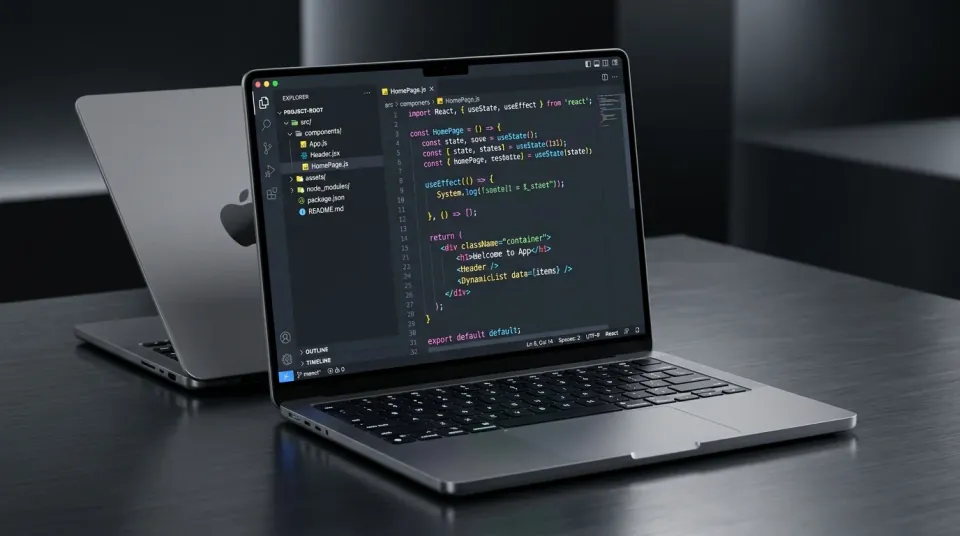
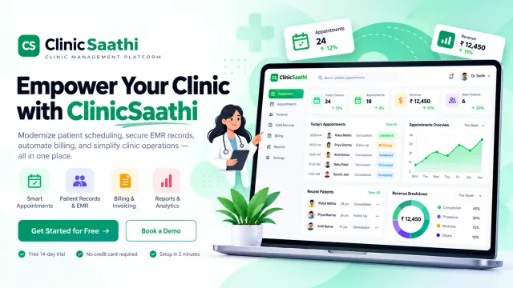
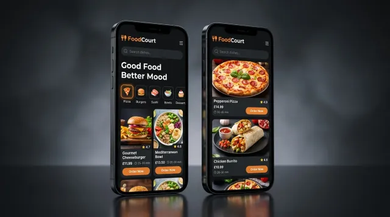

<div align="center">

<!-- ═══════════════════════════════════ NAVIGATION ═══════════════════════════════════ -->

<b><a href="https://lokeshsain.vercel.app/#home">Home</a></b> &nbsp;·&nbsp; 
<b><a href="https://lokeshsain.vercel.app/#about">About</a></b> &nbsp;·&nbsp; 
<b><a href="https://lokeshsain.vercel.app/#projects">Projects</a></b> &nbsp;·&nbsp; 
<b><a href="https://lokeshsain.vercel.app/#experience">Experience</a></b> &nbsp;·&nbsp; 
<b><a href="https://lokeshsain.vercel.app/#skills">Skills</a></b> &nbsp;·&nbsp; 
<b><a href="https://lokeshsain.vercel.app/#contact">Contact</a></b> &nbsp;·&nbsp; 
<b><a href="https://lokeshsain.vercel.app/blog">Perspectives</a></b>

<br/><br/>

<!-- ═══════════════════════════════════ HERO ═══════════════════════════════════ -->

<a href="https://lokeshsain.vercel.app/#contact">
  
</a>

# Software Engineer who turns ideas into real products.

<p align="center">
  <b>I build responsive web applications with React.js, integrate LLM APIs into product features, and enjoy solving real-world problems with clean, scalable and user-friendly solutions.</b>
</p>

📍 <b>Jaipur, Rajasthan, India</b>

<br/>

<!-- Hero Action Buttons -->
<a href="https://lokeshsain.vercel.app/#projects">
  
</a>
&nbsp;
<a href="https://drive.google.com/file/d/1d4qTGh5iNAv4ARXVWhOTjJL_gbgIgkJ0/view" target="_blank">
  
</a>

<br/><br/>

<!-- Social Profiles -->
<a href="https://github.com/thelokeshsain" target="_blank">
  
</a>
&nbsp;
<a href="https://www.linkedin.com/in/thelokeshsain/" target="_blank">
  
</a>
&nbsp;
<a href="https://x.com/thelokeshsain" target="_blank">
  
</a>
&nbsp;
<a href="https://www.instagram.com/thelokeshsain/" target="_blank">
  
</a>
&nbsp;
<a href="mailto:iamlokeshsain@gmail.com">
  
</a>

<br/><br/>

<!-- 3D Laptop Mockup Showcase (Optimized WebP served locally from repo) -->
<a href="https://lokeshsain.vercel.app">
  
</a>

<br/><br/>

### *Building what's next.*

`⚡ Clean Code` &nbsp;·&nbsp; `⚡ Scalable Products` &nbsp;·&nbsp; `⚡ Better Experiences`

</div>

<br/>

<!-- ════════════════════════════════ TECH STRIP ════════════════════════════════ -->

<div align="center">

```
TECH I WORK WITH
```

`React.js` &nbsp;·&nbsp; `JavaScript` &nbsp;·&nbsp; `Node.js` &nbsp;·&nbsp; `Python` &nbsp;·&nbsp; `MySQL` &nbsp;·&nbsp; `MongoDB` &nbsp;·&nbsp; `OpenAI` &nbsp;·&nbsp; `Gemini`

</div>

<br/>
<hr/>
<br/>

<!-- ════════════════════════════════ 02 / ABOUT ════════════════════════════════ -->

<div align="center">

`02 / ABOUT`

## More About Me

</div>

<p align="center">
  I'm <b>Lokesh Sain</b>, a full-stack software engineer based in Jaipur, India. I enjoy building web applications that are reliable, user-friendly and solve real problems. I'm especially interested in modern web technologies, scalable architectures and practical use cases of AI/LLM APIs in everyday products.
</p>

<p align="center">
  <a href="https://lokeshsain.vercel.app/#about">
    
  </a>
</p>

<br/>

### My Approach

<table width="100%">
  <tr>
    <td width="50%" valign="top">
      <h3><code>01</code> Understand Deeply</h3>
      <p>I take time to understand the problem and users.</p>
    </td>
    <td width="50%" valign="top">
      <h3><code>02</code> Build Iteratively</h3>
      <p>I prefer small, consistent iterations with real feedback.</p>
    </td>
  </tr>
  <tr>
    <td width="50%" valign="top">
      <h3><code>03</code> Keep It Simple</h3>
      <p>Clean, readable and maintainable code always.</p>
    </td>
    <td width="50%" valign="top">
      <h3><code>04</code> Focus on Impact</h3>
      <p>I care about building features that create real value.</p>
    </td>
  </tr>
</table>

<br/>
<hr/>
<br/>

<!-- ══════════════════════════ 03 / FEATURED PROJECTS ══════════════════════════ -->

<div align="center">

`03 / FEATURED PROJECTS`

## Projects I've Built

*A few projects that showcase my experience in full-stack development, real-world problem solving and building user-focused products.*

<br/>

<a href="https://lokeshsain.vercel.app/#projects">
  
</a>

</div>

<br/>

<table width="100%">
  <tr>
    <!-- Project 1: JZunto -->
    <td width="50%" valign="top">
      <a href="https://jzunto.app" target="_blank">
        
      </a>
      <br/><br/>
      <h3>JZunto</h3>
      <p>SPPU MCA exam-preparation platform combining curriculum navigation, PYQ pattern insights, curated resources, and structured practice-paper generation.</p>
      <p>
        <code>React</code> &nbsp; <code>AI</code> &nbsp; <code>Full Stack</code>
      </p>
      <p>
        <a href="https://jzunto.app" target="_blank"><b>View Details →</b></a> &nbsp;·&nbsp; 
        <a href="https://github.com/thelokeshsain" target="_blank"><b>View Code</b></a>
      </p>
    </td>
    <!-- Project 2: ClinicSathi -->
    <td width="50%" valign="top">
      <a href="https://clinicsathi-web.onrender.com/" target="_blank">
        
      </a>
      <br/><br/>
      <h3>ClinicSathi</h3>
      <p>Modern clinic-management web application designed to centralize clinical workflows and streamline day-to-day clinic operations.</p>
      <p>
        <code>React</code> &nbsp; <code>Full Stack</code> &nbsp; <code>AI</code>
      </p>
      <p>
        <a href="https://clinicsathi-web.onrender.com/" target="_blank"><b>View Details →</b></a> &nbsp;·&nbsp; 
        <a href="https://github.com/thelokeshsain" target="_blank"><b>View Code</b></a>
      </p>
    </td>
  </tr>
  <tr>
    <!-- Project 3: FoodCourt App -->
    <td width="50%" valign="top">
      <a href="https://github.com/thelokeshsain/FoodCourt" target="_blank">
        
      </a>
      <br/><br/>
      <h3>FoodCourt App</h3>
      <p>Android app streamlining cafeteria food ordering with real-time order tracking, Firebase auth, and Material Design UI.</p>
      <p>
        <code>Android</code> &nbsp; <code>Java</code> &nbsp; <code>Firebase</code>
      </p>
      <p>
        <a href="https://github.com/thelokeshsain/FoodCourt" target="_blank"><b>View Details →</b></a> &nbsp;·&nbsp; 
        <a href="https://github.com/thelokeshsain/FoodCourt" target="_blank"><b>View Code</b></a>
      </p>
    </td>
    <!-- More Projects Card -->
    <td width="50%" valign="middle" align="center">
      <br/>
      <h3>🚀 More Projects</h3>
      <p>Explore all web applications, full-stack tools, and AI experiments on my portfolio website.</p>
      <br/>
      <a href="https://lokeshsain.vercel.app/#projects">
        
      </a>
      <br/><br/>
    </td>
  </tr>
</table>

<br/>
<hr/>
<br/>

<!-- ══════════════════════════════ 04 / EXPERIENCE ══════════════════════════════ -->

<div align="center">

`04 / EXPERIENCE`

## My Professional Journey

</div>

<br/>

<table width="100%">
  <tr>
    <td width="30%" valign="top">
      <b>Jul 2025 – Present</b><br/>
      📍 <i>Jaipur, Rajasthan</i><br/><br/>
      <code>Full-time</code>
    </td>
    <td width="70%" valign="top">
      <h3>Software Engineer</h3>
      <p><b>3Handshake Techsoft Private Limited</b></p>
      <ul>
        <li>Building and maintaining web applications in React.js.</li>
        <li>Integrated LLM-powered image generation using OpenRouter API with Gemini.</li>
        <li>Used AI-assisted development tools (OpenAI Codex, Google Antigravity).</li>
        <li>Reduced page load time through lazy loading and improved user experience.</li>
      </ul>
    </td>
  </tr>
  <tr>
    <td width="30%" valign="top">
      <b>Jan 2025 – Jul 2025</b><br/>
      📍 <i>Jaipur, Rajasthan</i><br/><br/>
      <code>Internship</code>
    </td>
    <td width="70%" valign="top">
      <h3>Web Developer Intern</h3>
      <p><b>3Handshake Techsoft Private Limited</b></p>
      <ul>
        <li>Built responsive web interfaces using React.js, HTML5, CSS3 and JavaScript.</li>
        <li>Integrated RESTful APIs with error handling.</li>
        <li>Used React Hooks and Context API for state management.</li>
        <li>Developed reusable components and resolved production bugs.</li>
      </ul>
    </td>
  </tr>
</table>

<br/>
<hr/>
<br/>

<!-- ════════════════════════════════ 05 / SKILLS ════════════════════════════════ -->

<div align="center">

`05 / SKILLS`

## Technologies I Work With

<br/>

`JavaScript` &nbsp;·&nbsp; `React.js` &nbsp;·&nbsp; `Python` &nbsp;·&nbsp; `Node.js` &nbsp;·&nbsp; `OpenAI` &nbsp;·&nbsp; `Gemini` &nbsp;·&nbsp; `HTML5`

<br/>

`CSS3` &nbsp;·&nbsp; `REST APIs` &nbsp;·&nbsp; `LLM APIs` &nbsp;·&nbsp; `MySQL` &nbsp;·&nbsp; `MongoDB` &nbsp;·&nbsp; `Git` &nbsp;·&nbsp; `VS Code`

</div>

<br/>
<hr/>
<br/>

<!-- ═══════════════════════════════════ 06 / CONTACT ═══════════════════════════════════ -->

<div align="center">

`06 / CONTACT`

## Have a product to build?

<p align="center">
  I'm currently open to new opportunities and interesting projects. Whether it's a full-time role, freelance work or just a good conversation about tech — feel free to reach out.
</p>

<br/>

<a href="mailto:iamlokeshsain@gmail.com">
  
</a>
&nbsp;
<a href="https://www.linkedin.com/in/thelokeshsain/" target="_blank">
  
</a>
&nbsp;
<a href="https://github.com/thelokeshsain" target="_blank">
  
</a>
&nbsp;
<a href="https://x.com/thelokeshsain" target="_blank">
  
</a>
&nbsp;
<a href="https://www.instagram.com/thelokeshsain/" target="_blank">
  
</a>

<br/><br/>
<hr/>
<br/>

<!-- ═══════════════════════════════════════ FOOTER ═══════════════════════════════════════ -->

### [Lokesh Sain](https://lokeshsain.vercel.app)

*Software engineer crafting responsive web applications, high-performance systems, and intelligent product interfaces.*

📍 Jaipur, Rajasthan, India

[Home](https://lokeshsain.vercel.app/#home) · [Featured Projects](https://lokeshsain.vercel.app/#projects) · [Experience](https://lokeshsain.vercel.app/#experience) · [Skills & Tech](https://lokeshsain.vercel.app/#skills) · [Contact](https://lokeshsain.vercel.app/#contact) · [Perspectives (Blog)](https://lokeshsain.vercel.app/blog)

<br/>

© 2026 Lokesh Sain. Built with React.js & Next.js. &nbsp;·&nbsp; [Privacy Policy](https://lokeshsain.vercel.app/privacy-policy)

</div>
